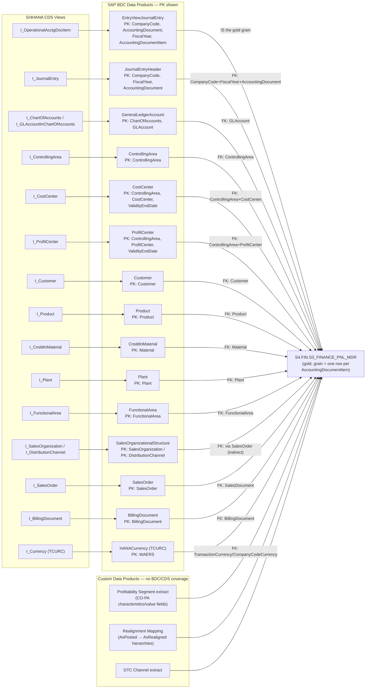

# Hydrate R.Daneel: SAP BDC → Gold Layer Data Lineage

## Purpose

This document maps the fields in the `S4.FIN.S3_FINANCE_PNL_MDR` gold table (defined in `DefinePnLTable.txt`) back to their source SAP CDS views and SAP Business Data Cloud (BDC) curated data products, identifies the gaps that have no standard BDC coverage, and documents the primary key (PK) / foreign key (FK) relationships needed to join everything together.

All entity names, field names, and key definitions below were verified directly against the CSN (Core Schema Notation) content in `TEMP.SAP.BDC_CHUNKS` — not inferred from naming conventions alone. Where something could not be verified, that is called out explicitly.

---

## 1. Scope: what's in the gold table

`S4.FIN` contains three tables. Only one overlaps with SAP source data:

| Table | SAP-sourced? | Notes |
|---|---|---|
| `S3_FINANCE_PNL_MDR` | Yes | P&L / CO-PA master data grain, ACDOCA-based. This is the focus of this document. |
| `RAW_FINANCIAL_EXTRACTS` | No | AI-parsed line items from PDF annual reports (`AI_PARSE_DOCUMENT`). No SAP source at all. |
| `PRODUCTS` | No | Marketing/website product catalog (name, description, URL, sector). Not SAP technical material master. |

---

## 2. Lineage diagram: CDS View → BDC Data Product → Gold Layer



---

## 3. Curated SAP BDC data products (verified)

Each row below is a real `source_document` in `TEMP.SAP.BDC_CHUNKS` — confirmed by direct query, not assumed.

| BDC Data Product | CSN File | Root CDS View (from `@EndUserText.label` i18n key) | Primary Key | What it hydrates |
|---|---|---|---|---|
| **EntryViewJournalEntry** | `sap-s4com-EntryViewJournalEntry-v1.csn.json` | `I_OperationalAcctgDocItem` | `CompanyCode`, `AccountingDocument`, `FiscalYear`, `AccountingDocumentItem` | The ACDOCA line-item grain itself — `HSL`, `ACDOCA_RACCT`, `COMPANYCODE`, `CONTROLLINGAREA`, `COSTCENTER`, `PARTNERPROFITCTR`, `PLANT`, `CUSTOMER`, `MATERIAL`, currency amounts |
| **JournalEntryHeader** | `sap-s4com-JournalEntryHeader-v1.csn.json` | `I_JournalEntry` | `CompanyCode`, `FiscalYear`, `AccountingDocument` | `MONTHYEAR`, `FISCALYEAR`, `POSTINGPERIOD`, `POSTINGDATE`, `LEDGER`, header-level currency/exchange rate |
| **GeneralLedgerAccount** | `sap-s4com-GeneralLedgerAccount-v1.csn.json` | `I_ChartOfAccounts` / `I_GLAccountInChartOfAccounts` | `ChartOfAccounts`, `GLAccount` | `ACDOCA_RACCT` master/hierarchy |
| **ControllingArea** | `sap-s4com-ControllingArea-v1.csn.json` | `I_ControllingArea` | `ControllingArea` | `CONTROLLINGAREA` master |
| **CostCenter** | `sap-s4com-CostCenter-v1.csn.json` | `I_CostCenter` | `ControllingArea`, `CostCenter`, `ValidityEndDate` | `COSTCENTER`, `ORIGINCCTR` master (incl. hierarchy) |
| **ProfitCenter** | `sap-s4com-ProfitCenter-v1.csn.json` | `I_ProfitCenter` | `ControllingArea`, `ProfitCenter`, `ValidityEndDate` | `PARTNERPROFITCTR` master |
| **Customer** | `sap-s4com-Customer-v1.csn.json` | `I_Customer` | `Customer` | `CUSTOMER`, `SHIPTOPARTY`, `CUSTOMERGROUP`, `CUST_SOLD_TO` |
| **Product** | `sap-s4com-Product-v1.csn.json` | `I_Product` | `Product` | `MATERIAL`, `BASEPRODUCT`, `UNIT`, current `CORPORATEBRAND`/`RANGEBRAND` |
| **CnsldtnMaterial** | `sap-s4com-CnsldtnMaterial-v1.csn.json` | `I_CnsldtnMaterial` | `Material` | Consolidated material view, material group |
| **Plant** | `sap-s4com-Plant-v1.csn.json` | `I_Plant` | `Plant` | `PLANT` master |
| **FunctionalArea** | `sap-s4com-FunctionalArea-v1.csn.json` | `I_FunctionalArea` | `FunctionalArea` | `FUNCTIONALAREA` master |
| **SalesOrganizationalStructure** | `sap-s4com-SalesOrganizationalStructure-v1.csn.json` | `I_SalesOrganization`, `I_DistributionChannel` (+ ~18 more sub-views: `SalesDistrict`, `Division`, `SalesOffice`, etc.) | `SalesOrganization` / `DistributionChannel` (independent keys per sub-entity) | `SALESORGANISATION`, `DISTRIBUTIONCHANNEL`, `SALESDISTRICT` |
| **SalesOrder** | `sap-s4com-SalesOrder-v1.csn.json` | `I_SalesOrder` | `SalesOrder` | `SALESORDER` |
| **BillingDocument** | `sap-s4com-BillingDocument-v1.csn.json` | `I_BillingDocument` | `BillingDocument` | `BILLINGTYPE`, billing document reference |
| **HANACurrency** | `sap-s4com-HANACurrency-v1.csn.json` | `I_Currency` (TCURC), `I_CurrencyText` (TCURT), `I_ExchangeRateType` (TCURV), etc. — a bundle of legacy currency dictionary views | `WAERS` (currency code) | `CURRENCY`, `CURRENCYUNIT`, `CURRENCYTYPE` |

**Coverage summary:** ~14 curated BDC data products cover the Universal Journal spine (postings, GL, cost/profit center, plant, customer/material master, sales org) — roughly 40 of the ~117 columns in `S3_FINANCE_PNL_MDR`.

---

## 4. Join keys: how the item entity connects to everything else

The grain of `S3_FINANCE_PNL_MDR` matches `OperationalAcctgDocItem` (the `EntryViewJournalEntry` data product) — one row per accounting document line item. All the foreign keys below were confirmed present as literal fields on that entity by extracting its full CSN field list (the earlier displayed content was truncated for readability, but the underlying field list is complete and was queried directly).

| Target dimension | FK field(s) on `OperationalAcctgDocItem` | Joins to PK on |
|---|---|---|
| GL Account | `GLAccount`, `OperationalGLAccount` | `GeneralLedgerAccount.ChartOfAccounts + GLAccount` |
| Controlling Area | `ControllingArea` | `ControllingArea.ControllingArea` |
| Cost Center | `ControllingArea` + `CostCenter` | `CostCenter.ControllingArea + CostCenter + ValidityEndDate` |
| Profit Center / Partner Profit Center | `ProfitCenter`, `PartnerProfitCenter` | `ProfitCenter.ControllingArea + ProfitCenter + ValidityEndDate` |
| Customer | `Customer` | `Customer.Customer` |
| Material | `Material` | `CnsldtnMaterial.Material` |
| Product | `Product` | `Product.Product` |
| Plant | `Plant` | `Plant.Plant` |
| Functional Area / Partner Functional Area | `FunctionalArea`, `PartnerFunctionalArea` | `FunctionalArea.FunctionalArea` |
| Sales Document | `SalesDocument` | `SalesOrder.SalesOrder` |
| Billing Document | `BillingDocument` | `BillingDocument.BillingDocument` |
| Currency | `TransactionCurrency`, `CompanyCodeCurrency`, `FunctionalCurrency` | `HANACurrency (TCURC).WAERS` — join on value, field names differ |
| Document header | `CompanyCode` + `FiscalYear` + `AccountingDocument` | `JournalEntryHeader.CompanyCode + FiscalYear + AccountingDocument` |

**Important exception — Sales Organization / Distribution Channel:** `SalesOrganization` and `DistributionChannel` are **not** fields on `OperationalAcctgDocItem`. There is no direct FK. The only path is a second hop: `OperationalAcctgDocItem.SalesDocument` → `SalesOrder.SalesOrganization`/`DistributionChannel`. Any pipeline populating `SALESORGANISATION`/`DISTRIBUTIONCHANNEL` in the gold table must go through the sales order (or billing document), not directly off the journal entry item.

---

## 5. Currency handling: is `HSL`/`CURRENCY`/`CURRENCYTYPE` safe to aggregate?

This deserves its own section because it's a common source of silently wrong P&L numbers, and the gold table's design raises a real question mark.

### 5.1 How SAP actually handles multi-currency amounts

`OperationalAcctgDocItem` (the source behind `EntryViewJournalEntry`) does **not** store one amount per line item — it stores several, pre-translated at posting time using rates from `TCURR` (the `HANACurrency`/`I_ExchangeRateRawData` entity). Each is a separate column on the same row:

| Currency role | Currency code field | Amount field |
|---|---|---|
| Transaction/document | `TransactionCurrency` | `AmountInTransactionCurrency` |
| Company code (local) | `CompanyCodeCurrency` | `AmountInCompanyCodeCurrency` |
| Functional | `FunctionalCurrency` | `AmountInFunctionalCurrency` |
| Additional 1 (role-driven — hard/group/index, per client config) | `AdditionalCurrency1` | `AmountInAdditionalCurrency1` |
| Additional 2 (role-driven) | `AdditionalCurrency2` | `AmountInAdditionalCurrency2` |
| Payment | `PaymentCurrency` | `AmountInPaymentCurrency` |

(These `AdditionalCurrency1/2` fields were missed in an earlier pass of this analysis — a regex used to extract currency fields didn't handle digit-suffixed names. Re-run against the full field list, they are confirmed present.)

This is the "pre-processing" the amounts already went through: translation happens once, upstream, in S/4HANA — not something the analytics layer should ever recompute. Consuming this **wide** layout (one row, many currency columns) is inherently safe — you just pick the column you need.

**Group currency is not one of these fields.** A dedicated `GroupCurrency`/`AmountInGroupCurrency` field does not exist anywhere in this entity. Consolidated/group-currency reporting in the BDC catalog lives in a **separate** data product — `CnsldtnGroupJournalEntry` (plus `ConsolidationVersion`) — not in `EntryViewJournalEntry`. Whether `AdditionalCurrency1`/`2` happen to be configured as group currency in a given SAP system is a client-specific setting, not something guaranteed by the schema.

### 5.2 The mismatch in the gold table

`S3_FINANCE_PNL_MDR` doesn't mirror that wide shape. It has:

```
HSL NUMBER(18,2)         -- one amount
CURRENCY VARCHAR(5)      -- one currency code
CURRENCYTYPE VARCHAR(2)  -- 'e.g. 10=company code, 30=group'
```

This is a **narrow/pivoted** shape — a single amount column tagged by a currency-type indicator — not the wide, native ACDOCA shape. `HSL` is also the classic SAP R/3-era field name (`BSEG-HSL`, or classic CO-PA `CE1xxxx-HSL`), which points to legacy FI/CO-PA extract naming conventions rather than the modern Universal Journal CDS field names. Something in the ETL has to explicitly remap `AmountInCompanyCodeCurrency → HSL`, `CompanyCodeCurrency → CURRENCY`, and decide what value `CURRENCYTYPE` gets — there's no field on the source entity literally called "currency type."

### 5.3 Two possible designs, two different risks

Without seeing the loaded data or ETL code, either of these is consistent with the DDL:

1. **`CURRENCYTYPE` is always `'10'`** (only company code/local currency is ever populated). In this case `CURRENCYTYPE` is vestigial, group/consolidated reporting isn't supported from this table at all, and — the real danger — **`SUM(HSL)` across multiple company codes with different local currencies silently mixes currencies** (summing USD + EUR + GBP as if they were the same unit). Nothing in the DDL prevents this; there's no constraint or semantic-layer guard forcing a `GROUP BY CURRENCY`.

2. **The ETL unions rows for multiple currency types** — e.g., pulling local-currency rows from `EntryViewJournalEntry` and group-currency rows from `CnsldtnGroupJournalEntry`, tagged by `CURRENCYTYPE`. In this case a naive `SUM(HSL)` without `WHERE CURRENCYTYPE = '10'` **double- or triple-counts every line**, because the same underlying transaction appears more than once at a different currency valuation.

Both are real correctness bugs waiting to happen; the DDL alone can't tell you which applies.

### 5.4 Recommended checks before trusting this table

1. `SELECT CURRENCYTYPE, COUNT(*) FROM S3_FINANCE_PNL_MDR GROUP BY 1` — if both `'10'` and `'30'` show up, the union/long design is real, and every downstream aggregate query needs an explicit `CURRENCYTYPE` filter.
2. On a sample of documents, check `COUNT(DISTINCT CURRENCYTYPE)` per `(COMPANYCODE, fiscal doc keys)` — more than one confirms the double-counting risk.
3. Check whether `CURRENCY` ever varies for a single `COMPANYCODE` — a company code has one fixed local currency, so variation would indicate a bug.
4. Confirm with the ETL owner whether group-currency rows (if present) are sourced from `CnsldtnGroupJournalEntry`, or just copy-cast from `AdditionalCurrency1/2` — the latter is only correct if that role is actually configured as group currency in this SAP system, which is not guaranteed.
5. Regardless of design, add a semantic-layer/BI safeguard — a metric definition that requires grouping by `CURRENCY` (or converts to one reporting currency) — rather than relying on analysts to remember to filter.

---

## 6. Custom data products required (no BDC/CDS coverage)

These fields have no matching CDS view or BDC entity anywhere in the catalog searched — they are client-configured extensions or entirely non-SAP data. Building them requires custom pipelines, not BDC subscriptions.

| Gap | Fields | Why it's custom | Suggested build |
|---|---|---|---|
| **CO-PA profitability segment** | `SALESVOLUME3000`, `INDQTY6210`, `QUANTITY`, `BASEQUANTITY`, all `VVxxx_ME` UOM fields, `OBJECTTYPE`, `ORIGINGROUP`, `SPECIALSCENARIO(_ID)`, `BUSINESS_TRANSACTION_CATEGORY`, `NON_GLOBE` | CO-PA characteristics/value fields are configured per client (KEA5/KE4M); no CDS view models a generic profitability segment | Custom extractor from ACDOCA CO-PA fields (`RKE_*`) or CE1xxxx table replication into a dedicated `PROFITABILITY_SEGMENT` data product |
| **Realignment / "AsPosted vs AsRealigned" hierarchies** | `SALESCREDITASPOSTED`/`REALIGNED`, `SALESCHANNELASPOSTED`/`REALIGNED`, `CUSTOMERCHANNELASPOSTED`/`REALIGNED`, `ECPRODUCTTYPE`/`GROUP`/`CATEGORY` (posted + realigned), `CORPORATEBRAND`/`RANGEBRAND` (posted + realigned), `LOCALPRODUCTHIGH`/`LOW`/`MIDDLE`, `CUSTOMERHIERARCHYASPOSTED03-06`, `CL3`-`CL6`, `COUNTRYCUSTHIER4`, `CUSTHIER_LEVEL`, `KEYCUSTOMER`, `REPORTINGUNITASREALIGNED` | Reporting realignment mappings, typically maintained in BW hierarchy nodes or governed Excel mappings outside S/4 master data | Custom "Realignment Mapping" data product — a versioned dimension table joining posted keys to current reporting hierarchy |
| **DTC (direct-to-consumer) channel** | `DTC_CATEGORY_DIMENSION_01-05`, `DTC_THIRD_TYPE`, `DTC_PRODUCT`, `DTC_REASON_CODE_BAD_GOODS`, `DTC_CHANNEL`, `DTC_REPORTING_QUANTITY(_UOM)`, `DTC_SALES_QUANTITY(_UOM)` | Bespoke e-commerce/DTC extension; not in any S/4 CDS view | Custom data product from the DTC/e-commerce platform (or Z-table extract) |
| **Pipeline/CDC bookkeeping** | `LASTUPDATE_TS_REPORTING`, `CFIN_TS_DELTA` | Ingestion metadata for the reporting layer, not SAP source data | Generated by the ingestion pipeline at load time |
| **`RAW_FINANCIAL_EXTRACTS`** | entire table | AI-parsed line items from PDF documents | Document-intelligence pipeline (unrelated to BDC) |
| **`PRODUCTS`** | entire table | Marketing/website product catalog — not SAP technical material master | Custom catalog ingestion (web/content pipeline), separate from `Product`/`CnsldtnMaterial` |

---

## 7. Verification methodology and caveats

Everything in this document was checked against `TEMP.SAP.BDC_CHUNKS` rather than asserted from memory or naming convention. Specifically:

1. **BDC data product existence** — confirmed each `source_document` literally exists via `SELECT DISTINCT source_document FROM TEMP.SAP.BDC_CHUNKS WHERE ...`.
2. **CDS view names** — extracted from the `@EndUserText.label: {i18n>I_XXX@ENDUSERTEXT.LABEL}` annotation in each entity's CSN block. SAP's convention is that this i18n label key equals the CDS view's technical name — a sourced signal, but still an inference from a naming convention, not an explicit "generated from CDS view I_XXX" statement in the CSN.
3. **Primary keys** — extracted via regex against `[key]`-tagged fields in each entity's CSN field list.
4. **Foreign keys** — extracted via regex against the full field list of `OperationalAcctgDocItem`, confirming each candidate FK field name is literally present (not assumed from the gold table's column names).

**Known limitations:**
- The BDC knowledge base (`TEMP.SAP.BDC_SEARCH`) was last refreshed **2026-03-31** — treat this as a point-in-time snapshot, not a live schema.
- The actual join logic used in any real ETL/replication pipeline was not inspected — this document describes what is *structurally possible* from the BDC schemas, not what a specific pipeline implementation does.
- `SalesOrganizationalStructure` bundles ~20 CDS views; only the two most relevant to the gold table (`SalesOrganization`, `DistributionChannel`) are detailed above.
- For an authoritative, audit-grade mapping, cross-check against the SAP BDC/S4HANA CDS view repository directly (SE11/Eclipse ADT), not this Cortex Search corpus.
